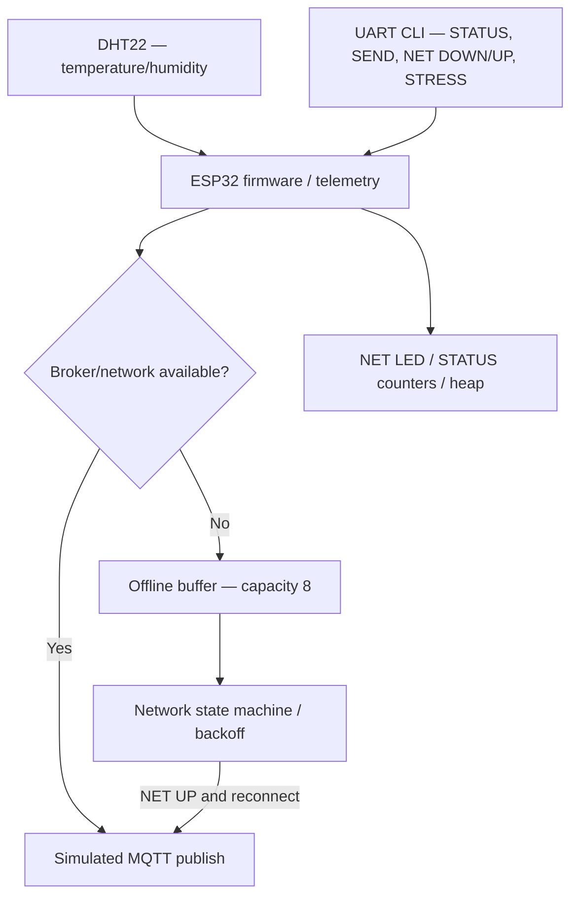
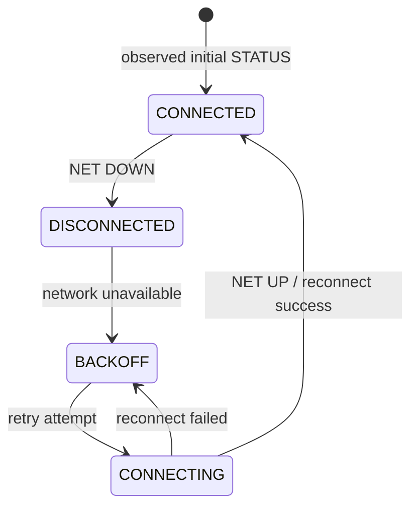

# 1–2 · Device Selection, System Overview & Test Scope

## Product concept and choice

**Selected device:** ESP32 IoT Environmental Monitoring Node, with a DHT22 environmental sensor, network state machine, a local telemetry buffer, simulated MQTT publishing and UART CLI fault-injection interface.

**Why this SUT?** It permits risk-driven tests of a connected device's most difficult operating condition: intermittent connectivity and eventual recovery. Prior Homework 7 produced concrete, reproducible UART evidence for these behaviors.

## Logical architecture

This is a **logical model**, not proof of the internal implementation. Online messages may publish directly without entering the offline buffer.

### Component responsibilities

| Component | Expected responsibility |
| --- | --- |
| ESP32 firmware | Acquire/generate telemetry, allocate message IDs, coordinate publish and state |
| DHT22 | Temperature/humidity input; physical calibration was not tested |
| Network state machine | Observable `DISCONNECTED`, `CONNECTING`, `CONNECTED`, `BACKOFF` |
| Offline buffer | Retain messages during outage; max 8; `DROP_OLDEST` on overflow |
| Simulated broker/publish | Send data on reconnect, without duplicate successful publish IDs |
| NET LED | Indicate `CONNECTED` (per exercise manual) |
| UART CLI / STATUS | Control fault injection and expose counters, network state and heap |

## State model

This chart summarizes **observed network states and transitions**, not an exhaustive firmware state machine or a verified boot transition sequence. Retry scheduling is evaluated in R2.

## In scope

- Network state transitions and the behavior of retry/backoff under loss.
- Retention of offline telemetry and delivery on reconnection.
- Buffer capacity 8, drop policy and correctness of `dropped` counters.
- Message ID integrity, duplicate publishing and ordered/complete flush.
- Stress publishing, free-heap trend, basic status observability.
- UART-based black-box fault injection and evidence gathering.

## Out of scope / future physical validation

- Physical radio/antenna performance, real Wi-Fi roaming and RF interference.
- Actual broker MQTT QoS, retained messages, broker acknowledgments and TLS.
- Power, battery use, current measurements, thermal/EMC and environmental robustness.
- Physical DHT22 calibration, sensor tolerance and environmental accuracy.
- Real flash persistence, power-loss recovery and long-production soak/CI.

## Test environment and interfaces

- VS Code / PlatformIO; ESP32 firmware in Wokwi Simulator.
- CLI: `STATUS`, `SEND`, `NET DOWN`, `NET UP`, `BUFFER`, `RESET STATS`, `STRESS N`.
- STATUS: `net`, `broker`, `buffer`, `capacity`, `sent`, `dropped`, `duplicates`, `reconnect_attempts`, `heap`.
- Requirements: R1–R8 from the provided `device_requirements.md`.
- Baseline at initial boot: `net=CONNECTED`, `broker=true`, `buffer=0`, `capacity=8`, all counters zero, heap 350,868 B.
- Later baseline for the stress phase: heap 349,884 B, which is **not** interchangeable with the initial boot measurement.

## System boundaries and data-flow assumptions

We treat `[MQTT] publish id=...` as simulated publish evidence for this educational protocol, not independent confirmation that an external broker acknowledged the packet. A PASS in Wokwi cannot substitute for real hardware integration testing.

[Back to Case Study](README.md)
